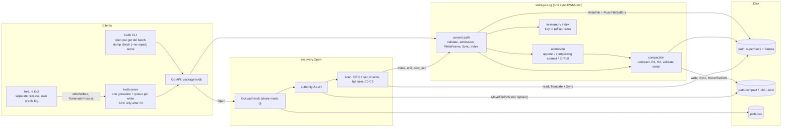
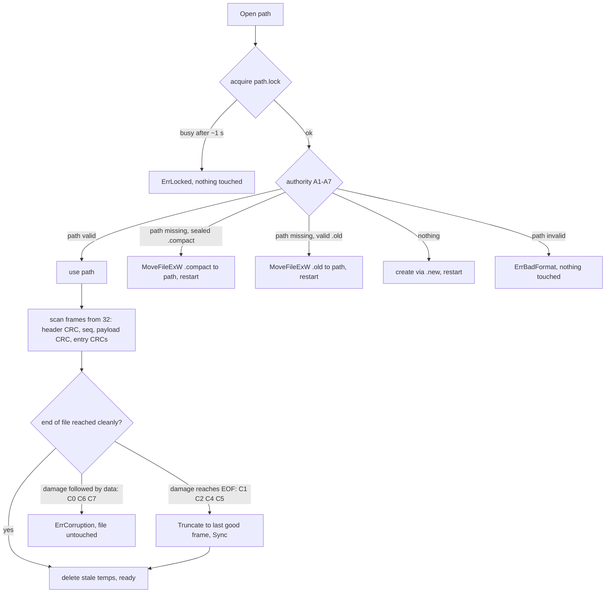

# NEXUS architecture

An append-only log of checksummed frames, an in-memory hash index rebuilt on
open, one global lock, and `fsync` before every acknowledgement. Detailed
design and its change log: [docs/DESIGN.md](docs/DESIGN.md); package layout
and Windows API decisions: [docs/ARCHITECTURE.md](docs/ARCHITECTURE.md).

## Components



Source: [diagrams/architecture.mmd](diagrams/architecture.mmd).

| Component | Code | Role |
|---|---|---|
| Client API | `src/kvdb` | `Open`, `Put`, `Get`, `Delete`, `Batch`, `Compact`, `Close`; `Stats`, `Range`, `Verify` for the CLI. Validates keys (1–1024 B), values (≤ 1 MiB), batches (≤ 10,000 ops). |
| CLI / serve | `src/internal/cli`, `src/cmd/kvdb` | The eight commands; serve protocol. |
| Write path | `storage.Log.Commit` → `commitLocked` (`src/internal/storage/log.go`) | One frame per operation, `Sync`, then index. |
| Index | `src/internal/index` | `map[string]Loc{Off, Size}` of live PUT entries + live-byte counter. Lives only in memory; rebuilt by recovery. |
| Log writer / codec | `src/internal/format` | Superblock, frame header, entries, CRC32C, streaming `WriteFrame` / `ScanPayload`. |
| Commit marker | frame header `payload_len` + payload CRC32C | A frame exists only if every byte and every CRC verifies. |
| Checksums | CRC32C on superblock, frame header, payload, each entry | Torn vs corrupt classification. |
| Admission | `src/internal/admission` | `max_bytes` decision and automatic compaction trigger. |
| Compaction | `storage.Log.compactLocked` (`src/internal/storage/compact.go`) | Snapshot to `.compact`, two non-replacing renames, validation, swap. |
| Recovery | `src/internal/recovery` | Lock, authority table A1–A7, scan, tail rules, truncation. |
| Locks | `src/internal/locking`, `storage.Log.mu` | Process lock file; in-process `sync.RWMutex`. |
| Platform | `src/internal/platform` | `MoveNoReplace` = `MoveFileExW(MOVEFILE_WRITE_THROUGH)`, never `MOVEFILE_REPLACE_EXISTING`; Windows error codes; `SyncDir`. |

## Design trade-offs

Each choice below was made for crash safety and simplicity in a 24-hour
build. The costs are real and are listed next to the reasons.

| Choice | Why | What it costs |
|---|---|---|
| **Go, standard library only** | Memory safety, with garbage-collection pauses that are small next to an `fsync` at this scale; direct access to the Windows API through `syscall` (`CreateFile` share modes, `FlushFileBuffers`, `MoveFileExW`); one static binary per platform; built-in testing, fuzzing and cross-compilation; no third-party code to audit. | No `-race` detector on this machine (it needs cgo and a C compiler); less control over memory layout than C or Rust; the index pays Go's per-entry map overhead (about 200 MB of heap for 1,000,000 short keys). |
| **Append-only log of checksummed frames** | A kill can only damage the end of the file, so recovery reduces to "find the last complete frame". Existing bytes are never overwritten, so an acknowledged write cannot be destroyed by a later one. One frame per write gives batch atomicity for free. | Every overwrite and delete leaves dead bytes; compaction is needed to reclaim them, costs I/O and briefly holds the write lock. Recovery replays the whole log (no checkpoint). |
| **In-memory hash index** (key → file offset) | O(1) lookups; one disk read per `get`; nothing to keep consistent on disk, because the index is rebuilt from the log on every open. Fewer on-disk structures means fewer crash states to get right. | All keys must fit in RAM. No ordered index: `dump` and `Range` sort keys first, and there are no range queries. Open time grows with the log (0.47 s for 1,000,000 keys here). |
| **One `sync.RWMutex` per database** | Commits are strictly ordered, so the log, the sequence numbers and the index can never disagree. It is easy to reason about and to test. Reads share the lock. | Writers are serialized, and a writer holds the lock **through** `fsync`, so readers wait for each sync too. There is no group commit, so durable single writes are limited by sync latency (about 2,600 synced puts/s here; `kvdb-bench`). Batches amortize it. |
| **CRC32C on every superblock, frame header, payload and entry** | Distinguishes a torn write (truncate safely) from real corruption (refuse to open), and lets `get` verify every value it returns. CRC32C has hardware support on x86 and ARM, and the Go standard library uses it, so checking is cheap. | It detects accidental damage only, not deliberate tampering (no cryptographic MAC). A flip in the last frame at the very end of the file is indistinguishable from a torn write. |
| **Sync before acknowledgement** | It is the only way to keep the promise "acknowledged means it survives a kill": success is returned only after `FlushFileBuffers`/`fsync` returned. If the sync fails, the answer is "outcome unknown", never success. | Write latency equals sync latency (about 0.5 ms per put on this NVMe SSD; far more on spinning disks). Throughput for single writes is bounded accordingly. |

**Current scalability limits.** One process per database (lock file). One
writer at a time inside that process. The index lives in RAM. Recovery time
is proportional to the log length, bounded only by automatic compaction
(file ≥ 4 MiB and more than twice its live size). Values up to 1 MiB, keys up
to 1 KiB, batches up to 10,000 operations. Compaction rewrites all live data
while holding the write lock. Tested on one Windows machine; cross-compiled
and vetted for Linux, macOS and FreeBSD, but not run there.

**What NEXUS deliberately does not support.** Multiple processes on one
database, network access, replication, transactions across batches, range
queries or secondary indexes, TTLs, compression, encryption or
authentication, SQL, and guarantees against power loss or deliberate
tampering. These are out of scope for a single-node, crash-safe key-value
store built for this challenge. They are not hidden features waiting to be
switched on.

## Binary format and file layout

```
 path:  [ SUPERBLOCK 32 B ][ FRAME ][ FRAME ] ... [ FRAME ]  EOF
 FRAME: [ HEADER 32 B ][ ENTRY ][ ENTRY ] ...      (payload_len bytes of entries)
```

| Structure | Field (offset: size) |
|---|---|
| Superblock (32 B) | 0: magic `KIPDBLOG` (8) · 8: version 1 (2) · 10: flags 0 (2) · 12: first_seq (8) · 20: snapshot_end (8) · 28: CRC32C(0–27) (4) |
| Frame header (32 B) | 0: magic `0xD8C3B1A5` (4) · 4: type 1 (1) · 5: reserved 0 (1) · 6: op_count (2) · 8: seq (8) · 16: payload_len (8) · 24: payload CRC32C (4) · 28: CRC32C(0–27) (4) |
| Entry (11 B + key + value) | 0: op 1=PUT 2=DEL (1) · 1: key_len (2) · 3: val_len (4) · 7: CRC32C(header 0–6 ‖ key ‖ value) (4) |

Little-endian. Full rules: [docs/FILE_FORMAT.md](docs/FILE_FORMAT.md).
**Append-only:** committed bytes are never modified; the only changes are
appending a frame, truncating a torn final frame, and replacing the whole file
through compaction.

## Write path and the Sync/ACK ordering

Numbered order for `Put`, `Delete` and `Batch` (all are `Commit`):

1. Validate key/value/batch limits (`kvdb.Op.Validate`, `ValidateBatch`); no I/O on failure.
2. Take the exclusive lock `storage.Log.mu`.
3. Net effect: a commit that changes nothing (only deletes of absent keys) returns `nil` with no I/O.
4. Admission (`admission.Decide`): append if the frame fits `max_bytes`; else a compacting commit if the compacted result fits; else `ErrFull` (nothing written).
5. **Append the frame**: `format.WriteFrame` → `WriteAt` (`WriteFile`) header then entries, in file order, at `end`.
6. **`File.Sync`** → `FlushFileBuffers` (Windows) / `fsync`.
7. Apply entries to the index in order (last op on a key wins), advance `end` and `next_seq`.
8. Return `nil` → **ACK** (`serve` prints `ACK <op-id>` only now).

Failures: a write error that is disk-full → truncate back to the frame start,
`fsync`, `ErrFull`, handle stays OPEN. Any other write error, or any `Sync`
error → `ErrOutcomeUnknown`, handle FAILED (rejects everything but `Close`), no
retry. Invariant I1: at most one unsynced frame exists and it is the last one.

## Batch atomicity

A batch of n operations is **one frame** with n entries. Recovery buffers a
frame's entries and applies them only after the payload CRC and every entry CRC
verified, so a frame is applied entirely or not at all. In memory, the index is
updated under the exclusive lock, so a concurrent `Get` (shared lock) sees the
state before or after the batch, never between. Order inside a batch: in
sequence, last operation on a key wins.

## Recovery flow



## Compaction and maxBytes

Compaction (`compactLocked`) runs under the exclusive lock: delete stale
temps → create `path.compact` → write live entries **sorted by key** (byte
order, so identical live state gives identical bytes; each value verified) as frames → `Sync` → superblock **last** → `Sync` → `Close` →
close the data handle → R1 `MoveFileExW(path, path.old)` → R2
`MoveFileExW(path.compact, path)` → `SyncDir` → reopen and fully scan the new file
and compare with the plan → swap file handle, index, end, next_seq → R3 delete
`.old`. Failures before R1 are definite (nothing changed); after R1 a failure
with a proven restore is definite, otherwise the handle goes FAILED and the
next open applies A3/A4. It runs automatically when the file is ≥ 4 MiB and more
than twice the estimated compacted size, on `kvdb.Compact()`, and as a
**compacting commit** when a write needs it to fit `max_bytes`.

`max_bytes` counts the data file only. An existing database larger than the
cap still opens. A PUT-bearing write must leave the file ≤ cap (append, or
compacting commit); a delete-only write may run on an over-cap file only if it
shrinks it; otherwise `ErrFull` and nothing changes.

## Locks

* **Process lock:** `path.lock` opened with `CreateFile` share mode 0 (Windows)
  or `flock` (Unix), held until `Close` or process death (the OS releases it on
  kill). A second process gets `ErrLocked` after ~1 s of retries and touches no
  file. The lock file is never deleted.
* **In-process:** one `sync.RWMutex` per open database. Writers (`Commit`,
  `Compact`, `Close`) take it exclusively, so concurrent writers are serialized
  around write + Sync + index update; `Get`, `Range`, `Verify`, `Stats` share it.
* **serve:** a goroutine and FIFO queue per writer ID keep each writer's order;
  stdout writes are serialized by a mutex and flushed per line.

## Error model

| Error | Meaning | Data |
|---|---|---|
| `ErrInvalidArgument`, `ErrTooLarge` | bad input | nothing written |
| `ErrFull` | cap, disk full (rolled back), limits | nothing changed (definite) |
| `ErrOutcomeUnknown` | Sync/write failure after bytes may be durable | all or nothing after reopen; handle FAILED |
| `ErrFailed` | handle is FAILED | nothing attempted |
| `ErrClosed` | handle closed | nothing attempted |
| `ErrLocked` | another process holds the database | nothing touched |
| `ErrCorruption` | damage a crash cannot explain | file untouched |
| `ErrBadFormat` | not a database file | file untouched |
| `ErrNotFound` | key absent | — |

## Torture tool

The official tester is **NEXUS Torture Engine 2.0** (`torture2/`, command
`nexus-torture`). It drives the real `kvdb` executable, kills and restarts it,
and judges every recovered state with an independent oracle that searches
for a legal execution (acknowledged, rejected and unknown requests;
real-time order; batch atomicity; last-op-wins; reads). It also runs the 32
official scenarios against the real executable and is itself checked by
mutation testing. Full design:
[docs/TORTURE_ARCHITECTURE.md](docs/TORTURE_ARCHITECTURE.md).

The first-generation tool below is kept because `go test ./src/scenarios`
builds and uses it.

`src/cmd/torture/` (separate binary, talks to the engine only through `kvdb serve`
over pipes):

1. Starts `kvdb serve <db>` as a child; N writers (≥ 2) each send one request,
   wait for its reply, record it, and continue. Requests: put, del, batch,
   get, compact, with values that embed the op ID so every value is unique.
2. Every request and reply is appended to `oracle.jsonl` (the tool's own
   file), with send and reply times.
3. After a random delay in ms (derived from `--seed` and the iteration), kills
   the child with `Process.Kill` (`TerminateProcess`), then reads every reply
   already written to the pipe, then `Wait`.
4. Runs `kvdb open` (and in `recovery-crash` mode first kills 1–3 `kvdb open`
   runs mid-recovery), `kvdb check` (must print `OK`), `kvdb dump`.
5. **Oracle check** (`src/cmd/torture/model.go`): starting from the verified state of
   the previous iteration, each write is acked, rejected (definite `ERR`
   class) or unknown (no reply / `ERR unknown`). For every key, the recovered
   value must be the previous value or the effect of an acked or applied-unknown
   request, and no acked request on that key may have *started after* the
   candidate finished. All 2^u applied/not-applied choices for the u ≤ writers
   unknown requests are tried, which also rejects partial batches. Untouched
   keys must be unchanged; get replies must return a value written to that key.
6. One summary line per iteration; on the first violation it stops and prints
   the key, expected candidates, found value and every op ID on that key.

`src/cmd/torture/model_test.go` proves the checker rejects lost writes, stale values,
partial batches, garbage and rejected values, and accepts all legal outcomes;
deliberately broken `kvdb` builds were caught (BREAKING.md §4).

## Proof table

"Verified by" names the executed test (all in `src/scenarios`, run with
`go test ./src/scenarios`; results in
[docs/results/SCENARIO_RESULTS.md](docs/results/SCENARIO_RESULTS.md)) and
the torture mode and seed where it applies. `log.go` = `src/internal/storage/log.go`,
`compact.go` = `src/internal/storage/compact.go`, `open.go`/`scan.go`/`authority.go`
= `src/internal/recovery/`.

| # | Scenario | Disk state at the kill | Mechanism | Where in code | Verified by |
|---|---|---|---|---|---|
| A1 | Kill before any byte of a put | committed frames only | nothing written before ACK | `log.go` `commitLocked` (write after admission) | `TestGroupA/A1` |
| A2 | Torn write | prefix of the last frame | CRC/length checks; tail rules C1/C2/C4; truncate | `scan.go` `Scan`, `open.go` `Open` (Truncate+Sync) | `TestGroupA/A2` (7 torn lengths) |
| A3 | Written, not fsynced | complete unsynced frame | frame valid ⇒ kept; never ACKed | `log.go` `commitLocked` (Sync before index) | `TestGroupA/A3` |
| A4 | After fsync, before return | durable frame | replay applies it | `scan.go` `Scan` | `TestGroupA/A4` |
| A5 | After put returned | durable frame | Sync before return/ACK | `log.go` `commitLocked`; `cli/serve.go` `execute` | `TestGroupA/A5` (serve kill-on-ACK ×20) |
| A6 | Kill during delete | DEL frame torn/complete | same as A1–A4 for a DEL entry | `log.go` `Delete` → `Commit` | `TestGroupA/A6` (crash sweep) |
| A7 | Kill during 1 MB put | large torn frame | streamed frame, CRC over 1 MiB | `format/stream.go` `WriteFrame`; `scan.go` | `TestGroupA/A7` sweep; torture `large-values` seed 999 |
| B1 | 3 of 10 written | header + 3 entries | frame applied only when complete | `scan.go` (entries buffered until CRC ok) | `TestGroupB/B1` |
| B2 | All 10 written, no marker | payload missing last byte / header zeroed | payload CRC is the marker; C4/C2 truncate | `scan.go`, `format/stream.go` `ScanPayload` | `TestGroupB/B2` |
| B3 | Marker written, not fsynced | complete unsynced frame | whole frame or nothing | `log.go` `commitLocked` | `TestGroupB/B3` |
| B4 | After batch success | durable frame | Sync before ACK | `log.go` `commitLocked` | `TestGroupB/B4` (in-process + serve) |
| B5 | put X + del X in one batch | one frame | in order, last op wins (README) | `log.go` index update loop; `scan.go` same order | `TestGroupB/B5`, `cli.TestBatchFileOrderingAndAtomicity` |
| B6 | 10,000-op batch killed halfway | 1M-key file + half a 220 KB frame | C4 truncation; recovery < 2 s | `scan.go`, `open.go` | `TestGroupB/B6`; torture `large-batch` seed 61 |
| C1 | Kill during replay | unchanged (scan is read-only) | re-scan | `scan.go` `Scan` | `TestGroupC/C1` (every scan op + 3-crash chains) |
| C2 | Kill during truncation | tail cut or not | truncate to same offset (idempotent) + Sync | `open.go` `Open` | `TestGroupC/C2` |
| C3 | Compaction before replace | `path` valid; `.compact` partial or sealed | A1: `path` wins; `.compact` deleted | `compact.go` phase A; `authority.go` `Resolve`, `RemoveStale` | `TestGroupC/C3` (sweep) |
| C4 | Mid rename/swap | no `path`, `.old` + sealed `.compact` | A3 adopts `.compact` (A4 `.old`); `MoveFileExW` never replaces | `compact.go` R1/R2; `authority.go` `adopt` | `TestGroupC/C4` |
| C5 | After swap, before cleanup | new `path` + `.old` | A1 uses `path`, deletes `.old` | `compact.go` R3; `authority.go` `RemoveStale` | `TestGroupC/C5`; torture `compaction` seed 7 |
| C6 | Kill during close | all acked frames synced | Close is not a durability point | `log.go` `Close` | `TestGroupC/C6` |
| D1 | Two writers, different keys | interleaved whole frames | exclusive lock around write+Sync+index | `log.go` `Commit` (`mu.Lock`) | torture `concurrent-disjoint` seed 101 (`TestGroupD/D1`) |
| D2 | Two writers, same key | whole frames | one frame per write, CRC per entry | `log.go`, `format` | torture `same-key` seed 202 (`TestGroupD/D2`) |
| D3 | Long batch + single puts | 10k-op frame torn or whole | batch = one frame | `log.go`, `scan.go` | torture `large-batch` seed 303 (`TestGroupD/D3`) |
| D4 | Get during batch | — (no crash) | index updated under exclusive lock; Get/Range under shared lock | `log.go` `Get`; `storage/inspect.go` `Range` | `TestGroupD/D4` |
| E1 | Cap during put | unchanged | admission before any byte | `admission.Decide`; `log.go` | `TestGroupE/E1` (+ CLI) |
| E2 | Cap halfway through batch | unchanged / rolled back | admission; disk-full rollback truncate + Sync | `log.go` `rollbackAfterWriteError` | `TestGroupE/E2` |
| E3 | Cap then kill | ≤ cap, acked frames | same as A-group | `log.go`, `scan.go` | `TestGroupE/E3`; torture `disk-full` seed 404 |
| E4 | Cap during compaction | `.compact` partial; or swap states | abort (definite) or A1/A3; commit inside snapshot | `compact.go` `compactLocked` | `TestGroupE/E4` (sweep of compacting commit) |
| E5 | Deletes free space, then writes | shrinking file | delete-only admission; compacting commit | `admission.Decide`; `compact.go` | `TestGroupE/E5` |
| F1 | 500 random kills | any of the above | all of the above | — | torture `default` seed 12345, 500 iterations (`TestGroupF/F1`, full mode) |
| F2 | Kills during recovery, repeated | partially recovered | recovery idempotent | `open.go`, `authority.go` | `TestGroupF/F2`; torture `recovery-crash` seed 42 |
| F3 | 1M keys, kill, open | 45 MB log | sequential 4 MiB-buffered scan | `scan.go` | `TestGroupF/F3` (serve child, `kvdb open` timed) |
| F4 | File truncated by 1 byte | last frame short by 1 byte | C4 truncates that frame only | `scan.go`, `open.go` | `TestGroupF/F4`; `cli.TestCheckReportsCorruptionAndTornTail` |

## Three guarantees

**1. Durability — once ACK is sent, the data survives.** `serve` prints
`ACK <op-id>` only after `kvdb.DB.Put/Delete/Batch` returned `nil`
(`cli/serve.go` `execute`). Those return `nil` only after `commitLocked`
called `WriteFile` (via `WriteAt`) for every byte of the frame and then
`File.Sync` → `FlushFileBuffers` returned success (`log.go`). After that the
bytes are in the file, so a process kill cannot remove them; recovery replays
every frame whose CRCs verify, and a complete synced frame always verifies.
Recovery may truncate only the final frame and only if its damage reaches EOF;
a synced, complete frame has no damage. If `FlushFileBuffers` fails, no ACK is
printed (`ErrOutcomeUnknown`) and the handle refuses all further writes.

**2. Atomicity — a batch is all or nothing.** A batch is one frame
(`WriteFrame` of all entries) whose header carries `payload_len` and the
CRC32C of the whole payload. During replay (`Scan`) entries are buffered and
applied to the index only after the payload CRC and every entry CRC verified;
a frame with any missing or damaged byte contributes nothing and, being the
last frame, is truncated. In memory the index is updated only after `Sync`,
under the exclusive lock, so readers never see part of a batch. Compaction
writes a new file and switches with `MoveFileExW` renames; a compacting commit
is inside the sealed snapshot, so it appears with the swap or not at all.

**3. Recoverability — open() never fails on a file we produced.** Our files
change only by: appending one frame at a time (I1: only the last can be torn),
truncating that frame (`Truncate` + `Sync`, to an offset determined by the bytes
before it, so repeating it is harmless), and compaction, which writes a complete
`.compact` (superblock written last and synced, so a valid superblock means a
complete file) and replaces the file with two non-replacing `MoveFileExW` calls.
At every kill point the authority table finds a complete file: `path` if
valid; else a sealed `.compact` (A3) or a valid `.old` (A4); else a new
database (A7). The lock (`CreateFile` share mode 0) guarantees one recovery at
a time. Every one of these states is produced and reopened by
`TestGroupC`, `TestGroupE/E4` and `recovery.TestAuthorityTable`.

## Read-only verification and independent cross-checks

* **`kvdb check`** = full recovery (it may cut a torn tail, finish an
  interrupted compaction and delete stale temps) followed by a re-read of the
  whole file (`Verify`).
* **`kvdb check --no-repair`** = `recovery.Inspect`. It takes the lock, walks
  the authority table without acting (`plan` mirrors `Resolve`), opens the
  file that is or would become the database **read-only**, and runs the same
  `Scan`. It prints `OK`, or `NEEDS REPAIR: <what open would change>` with
  exit code 4; real damage is `CORRUPT` / `BAD FORMAT` either way. Tests prove
  it performs only stat/open/read/size/close/lock operations
  (`recovery.TestInspect*`).
* **Independent implementation:** the teammate recovery package
  (`kipdb-recovery`) implements the same format separately. `crosscheck/`
  shows, in both directions, byte-identical encoding, interchangeable files
  and compaction, and identical torn-tail and corruption decisions
  ([docs/INDEPENDENT_VERIFICATION.md](docs/INDEPENDENT_VERIFICATION.md)). It
  is not a NEXUS dependency.
* **Torture tools:** Torture Engine 2.0 (`torture2/`, `nexus-torture`) is the
  official tester ([docs/TORTURE_ARCHITECTURE.md](docs/TORTURE_ARCHITECTURE.md));
  the first-generation `src/cmd/torture/` is used by the Go scenario tests.
