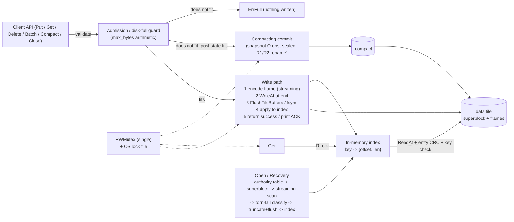

# Kill It and Prove It — Core Engine Design (v5, approved for implementation)

> **Purpose.** This is the single source of truth for the core key-value engine. It consolidates the full architecture review (v1 → v5), every resolved decision, the on-disk format, the protocols, the test plan and the open risks. Put it in the repository root (e.g. `docs/DESIGN.md`) so Claude Code and every team member work from the same specification.
>
> **Legend.** **[REQ §n]** = official requirement from the challenge statement, section *n*. **[ASSUME]** = our design assumption (confirm if marked with a judge question). **[OPT]** = optional, only after correctness. **[RISK]** = known remaining risk.
>
> **Status.** Design approved. Implementation has not started. Code must be written and committed to a fresh repository *after* the event start time **[REQ §3]**. Every AI prompt (including the ones that produced this document) must be logged in `PROMPTS.md`, unedited, with tool name and approximate time **[REQ §9]** — missing log = −10 points.

---

## Table of contents

1. Challenge summary (official requirements)
2. The invariant and the crash model
3. Architecture overview
4. Files on disk
5. On-disk format
6. Write path (PUT / DELETE / BATCH)
7. Read path (GET)
8. Recovery (OPEN)
9. Compaction protocol (Windows-safe)
10. Sequence numbers
11. `max_bytes` (disk-full) semantics
12. Concurrency and locking
13. Error model, handle states and the oracle contract
14. Public API and internal interfaces
15. CLI and `serve` protocol
16. Platform facts (verified) and Windows specifics
17. Recovery performance
18. Test strategy
19. Scenario-to-mechanism proof table (draft for ARCHITECTURE.md)
20. Crash points table (draft for BREAKING.md)
21. Implementation phases
22. Instructions for Claude Code
23. Decision log (what changed and why)
24. Known weaknesses and remaining risks
25. Questions for the judges
26. Team integration contract
27. Deliverables checklist

---

## 1. Challenge summary (official requirements)

### 1.1 What to build [REQ §2]
A single-process, embedded key-value database. One program, **exactly one authoritative data file**, plus an allowed lock file and temporary compaction file.

| Operation | Behaviour | Durability |
|---|---|---|
| `put(key, value)` | Store/overwrite | Once success returns, survives a crash |
| `get(key)` | Current value or "not found" | n/a |
| `delete(key)` | Remove; deleting a missing key is **not** an error | Once success returns, stays gone |
| `batch([ops])` | Puts/deletes applied atomically | Fully on disk or fully absent after a crash |
| `open(path)` | Open/create, recover from any crash | **< 2 s with 1,000,000 keys** |
| `close()` | Flush and close cleanly | Yes |

### 1.2 Limits [REQ §2]
- Keys: 1 – 1,024 bytes. Values: 0 – 1 MB (we accept up to 1,048,576 bytes **[ASSUME]**).
- ≥ 1,000,000 keys per database. Batch: up to 10,000 operations.

### 1.3 Concurrency [REQ §2]
- ≥ 2 threads/processes calling `put`, `delete`, `batch` concurrently without corruption or broken atomicity.
- `get` may run concurrently with writes and must see the state before or after a batch, never half.
- A single global lock is explicitly allowed.

### 1.4 Storage [REQ §2]
- Format is our choice (append-only log + index is explicitly acceptable; FAQ says it can score full marks).
- **File must shrink:** after 1,000,000 puts then 1,000,000 deletes, compaction must shrink the file. Compaction must be crash-safe. (−5 points if the file does not shrink.)

### 1.5 Disk full [REQ §2]
- Configurable maximum file size, e.g. `open(path, max_bytes=50_000_000)`.
- At the limit, a write fails cleanly with a clear error; the database remains fully readable and recoverable; existing data is never corrupted. (−10 points if disk-full corrupts or makes the file unopenable.)

### 1.6 Rules [REQ §3]
- Allowed: any language; full standard library incl. fsync/FlushFileBuffers; test frameworks; AI tools (logged).
- Banned: any DB/storage/persistence library, ORM/KV wrapper, any library implementing WAL/journaling/B-trees/LSM; copying DB source; pre-written code.
- Everything runs offline on our laptop; meaningful Git history; judge runs from our README.

### 1.7 Judging environment
- **Native Windows** (our laptop). Kill = `TerminateProcess` / Task Manager End Task **[REQ §4]**.

---

## 2. The invariant and the crash model

### 2.1 The invariant [REQ §4] — after any crash and completed `open()`:
1. Every operation that returned success before the crash is present.
2. Every operation that had not returned success is fully present or fully absent.
3. A batch counts as one operation; never partially present.
4. No key ever holds a value never written to it (no garbage, no torn values, no values from another key).
5. `open()` never fails on a file produced by our own database, however it was killed.

### 2.2 Crash model [REQ §4]
- Process killed with no cleanup, at any instruction: mid-`write()`, mid-fsync, mid-rename, mid-recovery.
- OS and disk are honest: once fsync returns, bytes are on disk.
- Crash during recovery must be safe.
- **Not required:** OS crash / power loss (bonus if claimed and justified). Bit-rot is **not tested** [REQ §5 G].

### 2.3 Consequences we rely on
- A killed process does **not** lose data already accepted by `write()`/`WriteFile`: it lives in the kernel page cache / Windows system cache, which survives process death. Directory-entry changes (rename) likewise survive.
- Therefore, under the official model, **correctness comes from the order of write/rename calls**; fsync provides power-loss durability (bonus, claimed on Linux/macOS only, not on Windows).
- We still call fsync/FlushFileBuffers before every ACK: the FAQ says judges may ask to prove where we call fsync.

### 2.4 Invariant I1 (internal, load-bearing)
**At most one uncommitted (unsynced, unacknowledged) frame can exist at any time, and if it exists it is the final frame of the log.** Every byte before the start of that frame belongs to frames that were fully written and synced.

Why it holds (each point is enforced, not assumed):
1. The exclusive writer lock serializes commits; only the lock holder writes.
2. A commit writes its frame only at the current end of the log, strictly sequentially, and calls `Sync` before releasing the lock, so the next commit starts only after the previous frame is complete and synced.
3. After any write, sync or rollback failure the frame is truncated away, or, if that cannot be proven, the handle enters FAILED and accepts no further writes (§6.3, §13.2). A failed frame can therefore never get a successor.
4. Group commit (several frames in flight before one sync) is excluded because it would break I1.
5. Compaction and compacting commits never append to a live log; they build a separate sealed file (§10).

What depends on I1: recovery's tail rules (§8.2). Because only the last frame can be torn, damage that is provably at the end of the log is a killed write and may be truncated, while damage followed by more data cannot be a killed write and must be refused.

Tests: TEST_PLAN.md T-I1-1 … T-I1-4 (Phase 2, storage fault injection).

---

## 3. Architecture overview

**Append-only log + in-memory hash index.** Every mutation (single put, single delete, batch) is encoded as **one checksummed frame**. A frame is valid only if both its header CRC and payload CRC verify, so atomicity comes from the format itself rather than from commit markers and transaction grouping.



Components:

| Component | Responsibility |
|---|---|
| Format codec | Encode/decode superblock, frame header, entries; all bounds and CRC checks; streaming encoder/decoder |
| `fileOps` | Thin wrapper over WriteAt / ReadAt / Sync / Truncate / Close for fault injection in tests |
| Log writer | Single write path (`commit`), short-write handling, truncate-on-failure |
| Index | `map` key → `{entry_offset u64, entry_len u32}`; live-byte and live-key counters |
| Admission guard | `max_bytes` arithmetic; chooses append / compacting commit / `ErrFull` |
| Recovery | Authority table, superblock validation, streaming scan, torn-tail classification, truncation |
| Compaction | Snapshot writer, sealing, close → R1 → R2 → R3 → reopen → swap |
| Lock manager | One `sync.RWMutex` + OS-level lock file |
| CLI / serve | 8 mandatory commands; `serve` multi-writer stdin protocol |

---

## 4. Files on disk

| File | Role | Lifetime |
|---|---|---|
| `<path>` | **The only authoritative data file** | Permanent |
| `<path>.lock` | OS-level exclusive lock (prevents a second process) | Held from open to close; stale file is harmless (lock is released by the kernel on process death) |
| `<path>.new` | Temp file used only while creating a brand-new database | Adopted or deleted by `open` |
| `<path>.compact` | Compaction / compacting-commit output | Adopted or deleted by `open` |
| `<path>.old` | Old data file during the two-step rename | Deleted after the swap or by `open` |

- `path` is the **data file path** (not a directory) **[REQ §2/§6: "open or create the database file"]**.
- The lock is on a **separate** file, never on the data file: compaction replaces the data file, and a lock on it would be lost with the inode.

---

## 5. On-disk format

All integers **little-endian**, encoded explicitly regardless of host byte order. Checksums are **CRC32C (Castagnoli)** (Go `hash/crc32`, hardware-accelerated).

### 5.1 Layout

```
offset 0                                  32                                    snapshot_end                 EOF
+-----------------------------------------+-------------------------------------+----------------------------+
| SUPERBLOCK (32 B, written once, sealed) | snapshot frames (from compaction)   | appended frames ...        |
+-----------------------------------------+-------------------------------------+----------------------------+

FRAME = FRAME HEADER (32 B) + PAYLOAD (payload_len bytes)
PAYLOAD = ENTRY_1 ... ENTRY_op_count
ENTRY = ENTRY HEADER (11 B) + key (key_len B) + value (val_len B)
```

### 5.2 Superblock — 32 bytes

| Offset | Size | Field | Rule |
|---|---|---|---|
| 0 | 8 | magic | ASCII `"KIPDBLOG"` |
| 8 | 2 | version (u16) | `1`; reject anything else |
| 10 | 2 | flags (u16) | `0`; reject non-zero |
| 12 | 8 | first_seq (u64) | ≥ 1; seq of the first frame in this file |
| 20 | 8 | snapshot_end (u64) | 32 ≤ value ≤ file size; must land exactly on a frame boundary |
| 28 | 4 | sb_crc (u32) | CRC32C of bytes 0–27 |

Total 8+2+2+8+8+4 = **32** ✓.

- The superblock is **never rewritten in place**. It is written once into a temp file (`.new` or `.compact`), and that temp file is renamed into place.
- **Sealing rule:** in a compaction file the superblock is written *last* (after the frames are flushed), then flushed again. Before that, offset 0 is zeros. **Valid superblock ⇔ file complete.**
- Fresh database: `first_seq = 1`, `snapshot_end = 32`.

### 5.3 Frame header — 32 bytes

| Offset | Size | Field | Rule |
|---|---|---|---|
| 0 | 4 | magic (u32) | `0xD8C3B1A5` (non-zero, non-ASCII, so zero-filled tails never match) |
| 4 | 1 | type (u8) | `1` = COMMIT_FRAME; all other values rejected |
| 5 | 1 | reserved | `0` |
| 6 | 2 | op_count (u16) | `1 ≤ n` and `n ≤ payload_len / 12`; user batches ≤ 10,000; compaction frames ≤ 65,535 |
| 8 | 8 | seq (u64) | first frame = `first_seq`; every later frame = previous + 1 |
| 16 | 8 | payload_len (u64) | `12 ≤ len ≤ MAX_PAYLOAD (2^40)` |
| 24 | 4 | payload_crc (u32) | CRC32C of the payload |
| 28 | 4 | header_crc (u32) | CRC32C of bytes 0–27 (so it also protects `payload_len` and `payload_crc`) |

Total 4+1+1+2+8+8+4+4 = **32** ✓.

### 5.4 Entry — 11-byte header + data

| Size | Field | Rule |
|---|---|---|
| 1 | op (u8) | `1` = PUT, `2` = DEL |
| 2 | key_len (u16) | 1 – 1,024 |
| 4 | val_len (u32) | 0 – 1,048,576; must be 0 for DEL |
| 4 | entry_crc (u32) | CRC32C of (op, key_len, val_len, key, value) — lets GET verify one value without re-reading the batch |
| key_len | key | |
| val_len | value | |

### 5.5 Constants

| Name | Value |
|---|---|
| `SB_SIZE`, `FRAME_HDR_SIZE` | 32 |
| `ENTRY_HDR_SIZE` | 11 |
| `MIN_ENTRY_SIZE` | 12 (11 + 1-byte key) |
| `MAX_KEY` | 1,024 |
| `MAX_VALUE` | 1,048,576 |
| `MAX_BATCH_OPS` | 10,000 (user batches) |
| `MAX_FRAME_OPS` | 65,535 (u16; compaction frames) |
| `MAX_PAYLOAD` | 2^40 (covers 10,000 × (11+1,024+1,048,576) ≈ 10.5 GB user batch and 65,535 × ~1 MiB ≈ 68.8 GB compaction frame) |
| `FRAME_MAGIC` | `0xD8C3B1A5` |
| `SB_MAGIC` | `"KIPDBLOG"` |
| `FORMAT_VERSION` | 1 |

`MAX_PAYLOAD` is fixed per format version and may never decrease.

### 5.6 Validation and overflow checks (in this order)
1. All file positions are `uint64`. File size comes from `Stat` (int64 ≥ 0). 64-bit targets only (amd64/arm64); the build refuses 32-bit.
2. Header read: require `size − pos ≥ 32` (subtract, never add).
3. `payload_len ≤ MAX_PAYLOAD` is checked **before** `payload_len ≤ size − pos − 32`; only then is anything allocated or read.
4. `op_count ≥ 1` and `op_count ≤ payload_len / 12` before looping.
5. Per entry (cursor `c`, payload length `n`): `n − c ≥ 11`; `op ∈ {1,2}`; `1 ≤ key_len ≤ 1,024`; `val_len ≤ 1,048,576`; DEL ⇒ `val_len == 0`; `uint64(key_len) + uint64(val_len) ≤ n − c − 11`.
6. After the loop: `c == n` exactly and entries parsed == `op_count`.
7. A frame whose CRCs pass but whose structure is malformed is **corruption / version bug**, never a torn write.
8. Encoding: total frame size computed in `uint64` and checked against limits before any I/O.
9. `next_seq` wraparound to 0 → hard error.
10. Index location `{offset u64, len u32}`: `len = 11 + key + value < 2^32` ✓. GET requires `ReadAt` to return exactly `len` bytes.

---

## 6. Write path (PUT / DELETE / BATCH)

### 6.1 One write path
- `Put(k, v)` = `commit([PUT k v])`; `Delete(k)` = `commit([DEL k])`; `Batch(ops)` = `commit(ops)`.
- **Single `Delete` of a missing key:** returns success with **no I/O** (the index reflects synced state, so the key is absent on disk too) **[REQ §2: not an error]**.
- **Batch semantics [REQ B5]:** operations apply **in order; the last operation on a key wins**. `put X 1, put X 2` → 2; `put X, del X` → absent; `del X, put X` → present. Documented in README.
- **Empty batch [ASSUME]:** successful no-op, no I/O.
- **Caller contract:** the caller must not modify the key/value slices during a `Batch` call (the streaming encoder reads them twice). Documented.

### 6.2 `commit(ops)` — exact sequence
1. **Validate** every op (key 1–1,024 B, value ≤ 1,048,576 B, ≤ 10,000 ops). Reject → `ErrInvalidArgument` / `ErrTooLarge` (nothing written).
2. Acquire the **exclusive lock**. If state ≠ OPEN → `ErrClosed` / `ErrFailed`.
3. **Pass 1 (no copying):** compute every `entry_crc` and the streaming `payload_crc` directly over the caller's slices; compute exact `frame_size = 32 + Σ(11 + key_len + val_len)` in `uint64`.
4. **Admission** (§11): append / compacting commit / `ErrFull`. Pure arithmetic, before any I/O.
5. **Append path:** `WriteAt` the 32-byte header at `end`, then the entries through a 1 MiB staging buffer; values ≥ 256 KiB are written directly from the caller's slice. Bytes reach the file strictly sequentially, so a kill leaves a **prefix** of the frame.
6. **`Sync()`** (`FlushFileBuffers` on Windows, `fsync` on Linux, `F_FULLFSYNC` on macOS).
7. Apply all entries to the index **in order** (PUT sets location, DEL removes key); update `end`, `next_seq`, `live_bytes`, `L`.
8. Release the lock and **return success**. `serve` prints `ACK <op-id>` only now.

### 6.3 Failure handling inside the write path
| Failure | Action | Returned | Handle |
|---|---|---|---|
| Validation fails | nothing written | `ErrInvalidArgument` / `ErrTooLarge` | OPEN |
| Admission says no | nothing written | `ErrFull` | OPEN |
| `WriteAt` fails with disk-full (Windows 112/39, Unix ENOSPC) | truncate to frame start `end` + flush; if both succeed | `ErrFull` (definite) | OPEN |
| `WriteAt` fails otherwise, or truncate/flush after it fails | best-effort truncate to `end` | `ErrOutcomeUnknown` | **FAILED** |
| `Sync` fails | **never retry** (fsyncgate: a retry can falsely succeed after dirty pages were dropped); best-effort truncate to `end` + flush | `ErrOutcomeUnknown` | **FAILED** |

- Truncate always goes back to the **frame start** (`end`), never `end + n`.
- The index and counters are never touched on any failure.

**Implementation notes (Phase 2 Stage 3, 2026-11-06; `src/internal/storage/log.go`, `src/kvdb/db.go`).**

* **F1 — no Sync after the post-Sync-failure truncate.** After a failed `Sync`, the frame is truncated best-effort but **no second `Sync` is issued**, so nothing could be mistaken for a successful retry (T-I1-3: "no retry of Sync"). The result is `ErrOutcomeUnknown` either way, and the next Open re-derives the state from the bytes. *(Approved 2026-11-06.)* Invariants, each pinned by `storage.TestF1SyncFailureInvariants`:
  1. A failed `Sync` returns `ErrOutcomeUnknown`: never nil (definite success) and never `ErrFull` or another definite error (definite absence).
  2. The handle enters FAILED and rejects every further operation (Put, Delete, Batch, Get, Compact, even an empty Batch) with `ErrFailed` and no I/O; only Close is accepted.
  3. Nothing is retried automatically: after the failure the data file sees exactly one best-effort `Truncate` and no further `WriteAt` or `Sync`, ever.
  4. After reopening, the operation is either fully present or fully absent, never partially applied. The test reaches both outcomes.
  5. A failed rollback (truncate) cannot turn the unknown outcome into a definite one. The same rule applies to WriteAt failures: disk-full becomes the definite `ErrFull` only when both the truncate and its `Sync` succeeded; otherwise it is `ErrOutcomeUnknown`. The compaction failure paths in §11.3 follow the same rule.
* **F2 — a write failure that is not disk-full is `ErrOutcomeUnknown` + FAILED even if the rollback succeeded**, exactly as the table says. Only disk-full with a successful truncate and `Sync` is the definite `ErrFull` that keeps the handle OPEN. T-I1-1 ("rollback succeeds, next commit at the old end") is therefore tested with a disk-full error.
* **F3 — FAILED rejects Get too** (§13.2 "reject subsequent operations"); only Close is allowed. `Close` twice returns nil; every other call after Close returns `ErrClosed` (an empty batch included).
* **F4 — limits that cannot be met are a definite `ErrFull` with no I/O:** sequence numbers exhausted (`NextSeq = 0`, note E4), or a frame that would pass the maximum file offset.
* **F5 — Phase 2 API scope.** `Compact` is not exposed until Phase 3 (no stub). `Open(path, maxBytes)` validates `maxBytes` (0 = unlimited; negative or 1–31 → `ErrInvalidArgument`) and records it, but admission is not enforced until Phase 3.
* **F6 — empty values.** `Put(k, nil)` stores an empty value; `Get` returns a non-nil empty slice, so present-but-empty is distinguishable from `ErrNotFound`.
* **F7 — Get checks the entry type:** an index location that decodes to a DEL entry is `ErrCorruption` (defence in depth next to the CRC and key checks).

### 6.4 Durability ordering (summary)
| Operation | Order |
|---|---|
| Create database | write superblock to `.new` → flush → close → `MoveFile(.new → path)` (path absent) → (Unix: fsync directory) → open |
| Commit | `WriteAt` (header, then payload chunks) → `Sync` → index update → success/ACK |
| Recovery truncate | truncate → `Sync` → only then accept writes |
| Compaction | §9 |
| Close | not a durability point (every ACKed op is already flushed); releases lock, closes handles |

---

## 7. Read path (GET)
1. Acquire the **shared lock**; check state.
2. Look up the key; absent → `ErrNotFound`.
3. `ReadAt(entry_len, entry_offset)`; a short read (`io.EOF`) → `ErrCorruption`.
4. Verify `entry_crc` **and** that the stored key equals the requested key (defence in depth for invariant rule 4).
5. Return a **copy** of the value. Release the lock.

The shared lock is held across lookup **and** read, so the file handle cannot be swapped or closed mid-read. Bytes at an indexed offset never change (append-only), so reads cannot be torn.

---

> **Note (added 2026-11-06):** sections 8–27 below were provided separately as a continuation of this document. Their numbering and titles differ from the table of contents at the top; the continuation below is authoritative for sections 8–27.

# DESIGN.md — Continuation

## 8. Recovery Architecture

**[REQ]**
- Acknowledged writes must survive process termination.
- Incomplete operations must be completely committed or discarded.
- Recovery must reconstruct the database's latest state.
- Recovery must be repeatable.
- Opening a database produced by our own implementation must not fail.

**[ASSUME]** The append-only log is the authoritative source of truth. The in-memory index is reconstructed during recovery.

Recovery proceeds in this order:

0. **Acquire the process lock (`path.lock`, §16.1) before anything else.** No authority resolution, stat-based decision, rename, deletion, temporary-file cleanup, truncation or database creation may happen without it. If the lock cannot be acquired, return `ErrLocked` without touching any file. *(Correction 2026-11-06: authority resolution changes files, so two processes opening at once must never both run it.)*
1. Resolve the authoritative database file using the temporary-file authority protocol.
2. Open and validate the 32-byte superblock.
3. Read the file size.
4. Initialize the in-memory index and sequence counter.
5. Scan frames sequentially, starting at offset 32.
6. Validate each frame header and payload.
7. Verify CRC32C checksums.
8. Verify contiguous sequence numbers.
9. Apply entries only after the complete frame has passed validation.
10. Classify any incomplete or damaged tail.
11. Truncate a proven damaged tail when permitted.
12. Sync after truncation.
13. Recompute live and dead byte counters.
14. Mark the database ready.

### 8.1 Frame validation

A frame is accepted only when:

- Its header is valid.
- Its sequence number is correct.
- Its payload length is within the format limit.
- Its payload checksum matches.
- Every entry is structurally valid.
- Every entry checksum matches.
- The operation count matches the decoded entries.

Entries remain provisional until the entire frame passes validation.

A partially written batch must never partially update the index.

### 8.2 Damaged tail versus corruption

The decoder distinguishes three classes:

- **Damaged:** Bad magic, checksum mismatch, or data ending prematurely.
- **Corrupt:** Checksums pass, but the structure is invalid.
- **I/O:** An actual operating-system read error.

*(Correction 2026-11-06.)* "Outside the protected snapshot" is necessary but **not sufficient** for truncation. The damage must also be provably the final frame, which invariant I1 (§2.4) makes decidable. Let `pos` be the start of the first frame that fails, `size` the file size and `expected` the next sequence number:

| Rule | Situation at `pos` | Decision |
|---|---|---|
| C0 | `pos < snapshot_end` (any failure inside the sealed snapshot) | **Refuse** with `ErrCorruption`. Never truncate. |
| C1 | Fewer than 32 bytes remain (`size − pos < 32`) | Torn final frame → truncate to `pos`. |
| C2 | Header has bad magic or bad header CRC | Torn final frame → truncate to `pos`. |
| C3 | (applies to C2) | **Do not scan forward** for another valid-looking frame header. User values may contain byte sequences that form valid headers, even with the expected seq; a forward scan would make Open refuse a file our own engine wrote (breaking invariant rule 5). Under I1 and the official crash model (no bit-rot), a damaged header can only be the torn final frame. |
| C4 | Header valid, `payload_len` runs past EOF (`!PayloadFits`) | Torn final frame → truncate to `pos`. |
| C5 | Header valid, payload fits, payload CRC wrong, and the declared frame end `pos + 32 + payload_len` **equals** `size` | Torn final frame → truncate to `pos`. |
| C6 | Header valid, payload fits, payload CRC wrong, declared frame end **< `size`** | **Refuse** with `ErrCorruption`. Bytes after a torn frame are impossible under I1. |
| C7 | Header CRC-valid but `seq ≠ expected`, or any `ErrMalformed` / entry-CRC failure inside a payload whose CRC matches | **Refuse** with `ErrCorruption` (Corrupt class; a torn write cannot produce this). |
| C8 | Any error from the reader (I/O class) | **Fail Open without modifying the file.** Never treat it as EOF, never truncate. |

Truncation is done only by C1, C2, C4 and C5, always to exactly `pos`, never below `snapshot_end`, and is followed by `Sync` before any write is accepted.

Recovery must not silently truncate structurally corrupt data whose checksums validate.

A real read error must never be interpreted as EOF and must never cause truncation.

**Implementation notes (Phase 2 Stage 2, 2026-11-06; `src/internal/recovery/scan.go`, `open.go`).** These refinements fill in cases the table leaves implicit; none relaxes it:

* **E1 — a short read is C8, not a torn tail.** Every C rule is decided from the file size obtained before the scan. If a read then returns end-of-file before that size (the file shrank underneath, or a faulty read), Open fails with an I/O error and truncates nothing. Only `size − pos` and decoded bytes can justify truncation.
* **E2 — a CRC-valid header with an invalid field** (type ≠ 1, reserved ≠ 0, op_count/payload_len out of range) is C7 (`ErrMalformed`), not C2.
* **E3 — `snapshot_end` must fall on a frame boundary.** A valid frame that starts before `snapshot_end` and ends after it is refused with `ErrCorruption` (C0).
* **E4 — sequence exhaustion.** After a valid frame with seq 2^64−1, `NextSeq` is reported as 0 (exhausted). Any later CRC-valid header is C7; a torn tail after it is still truncated. The write path (Stage 3) must refuse writes when `NextSeq` is 0.
* **E5 — the superblock is re-read through the read-write handle** that the scan and the write path use, so a change between Resolve and Open cannot slip through (classified as A2 / D1).
* **E6 — defensive truncation guard.** Open refuses to truncate unless `snapshot_end ≤ End < size`, which Scan already guarantees.
* Order inside Open: lock → Resolve → open read-write → re-check superblock → Scan (read-only) → truncate to exactly `End` → `Sync` → `RemoveStale` (D2). A kill anywhere in that sequence, including between the truncate and the sync, is followed by an Open that reaches the same state (T-REC-12).

### 8.3 Snapshot boundary

The superblock's `snapshot_end` identifies the end of the protected compacted region.

Recovery must never truncate below this offset.

Damage inside the protected snapshot is corruption, not an incomplete append.

### 8.4 Recovery performance

**[REQ]** Opening a database with one million keys must complete in under two seconds.

Measure:
- File scanning time.
- CRC calculation time.
- Index reconstruction time.
- Total Open duration.
- Peak memory usage.

Use a 4 MiB read buffer initially. Further optimizations may include pre-sizing the index, sequential scan hints and allocation reduction.

Do not disable checksum validation to improve performance.

---

## 9. Sequence Number Management

Every committed frame has a monotonically increasing sequence number.

The superblock stores `first_seq`.

The first frame after the superblock must have sequence `first_seq`.

Each subsequent frame increments the sequence by one.

The next sequence number is maintained in memory as `next_seq`.

### 9.1 Compaction sequence handling

Compaction creates a new log containing the current live state.

The new file's `first_seq` is the old database's `next_seq`.

The compacted frames are assigned contiguous sequence numbers starting from that value.

New writes continue after the compacted frames.

Sequence numbers identify positions in database history, not individual user operations.

### 9.2 Empty database

When compaction removes all live keys:

- The new superblock has `first_seq` equal to the old `next_seq`.
- `snapshot_end` equals 32.
- There are no frames.
- The next write uses `first_seq`.

Compaction is a no-op when the existing database has no frames.

The implementation must guard against sequence-number overflow.

---

## 10. Compaction Architecture

Compaction is mandatory.

The append-only log accumulates obsolete records when keys are overwritten or deleted.

Compaction rewrites only the latest live state into a new database file.

For each key:
- Keep the latest PUT if the key is live.
- Exclude deleted keys.
- Exclude superseded PUT records.

### 10.1 Compaction trigger

Automatic compaction is initially triggered when:

- The file is at least 4 MiB.
- The file is more than twice its estimated compacted size.

A second trigger may be introduced when the file exceeds a benchmark-derived `RECOVERY_SAFE_BYTES` threshold.

### 10.2 Compaction process

1. Acquire the exclusive database lock.
2. Confirm that the database has at least one frame.
3. Calculate the compacted output size.
4. Create the `.compact` file.
5. Write compacted frames.
6. Sync the frames.
7. Write the superblock last.
8. Sync again.
9. Close the temporary file.
10. Close the old data-file handle.
11. Perform the Windows two-rename replacement protocol.
12. Reopen and validate the resulting database.
13. Swap the in-memory index and counters.
14. Remove obsolete temporary files best-effort.

The old index and counters must remain authoritative until the replacement succeeds and the new file has been validated.

### 10.3 Compaction and concurrent operations

Compaction holds the exclusive lock.

No reads or writes may observe an intermediate database state.

All concurrent operations resume after compaction completes.

### 10.4 Compaction correctness

Plain compaction preserves all live key-value pairs.

A compacting commit preserves the old state plus the new commit.

The new state must not be acknowledged until the replacement has succeeded.

### 10.5 Implementation notes (Phase 3, 2026-11-06; `src/internal/storage/compact.go`, `src/internal/admission`) — pending review

* **G1 — where.** Compaction needs the open handle's file, index and lock, so it lives in package `storage` next to the commit path. Package `admission` holds the pure size rules and the trigger. Package `compaction` is intentionally empty.
* **G2 — snapshot layout.** The live keys (minus keys the commit touches) are copied in **file-offset order**, so the old file is read sequentially. Every copied value is verified (entry CRC, stored key, PUT type) and a mismatch aborts with `ErrCorruption`. The commit's final PUTs follow. Frames hold at most 65,535 entries and 4 MiB of payload (one maximal entry always fits). Sequence numbers start at the old `next_seq` (§9.1). The superblock has `snapshot_end` = end of the last frame and is written **last**, after the frames are synced, then synced again (§10.2 steps 5–8). Gaps 0–31 read as zeros until the seal, so an unfinished `.compact` is unsealed.
* **G3 — compacting commit.** The whole result (old live state with the commit applied) is written as the snapshot; the commit has no separate frame. It is acknowledged only after R2, the directory sync, and validation of the reopened file.
* **G4 — validation before swap (§10.2 step 12).** The new `path` is reopened and fully scanned with `recovery.ScanFile`. The superblock, end, frame count and key count must match the plan exactly and the tail must be clean. Only then are the file handle, index, end and `next_seq` swapped. R3 (delete `.old`) is best-effort afterwards.
* **G5 — failure classes.** These follow §11.3 and the F1 rule that a failed rollback never yields a definite answer:
  - **Phase A** (building `.compact`; the live file is untouched): every failure is definite and the handle stays OPEN. `.compact` is removed best-effort. Disk-full → `ErrFull`; a damaged live entry → `ErrCorruption`; anything else → the wrapped OS error.
  - **Phase B** (after closing the data handle): if the old file is back at `path` and reopened (R1 failed, or R2 failed and the restore `.old → path` succeeded), the result is definite and the handle stays OPEN with the old index.
  - **Any other Phase B failure** (restore failed, reopen failed, directory sync failed, validation failed): the handle becomes FAILED. A compacting commit returns `ErrOutcomeUnknown`; a plain compaction returns `ErrFailed` (no user operation is in doubt; the live data is the same either way).
* **G6 — non-replacing moves pay off.** If R2 actually happened but reported an error, the restore `MoveNoReplace(.old → path)` fails because `path` exists, so the new file is never clobbered. Pinned by the fail-after cases of `TestCompactFaultSweep`. Moves, deletes and reopens retry sharing violations (antivirus) with `fileio.DefaultRetry`.
* **G7 — automatic trigger (§10.1).** After a successful append, if the file is ≥ 4 MiB and more than twice a cheap estimate of the compacted size, the exact plan is computed and the compaction runs if it strictly shrinks the file. The commit was already durable, so it returns nil whatever the compaction does (if the compaction fails, both the old and new files contain the commit). The optional `RECOVERY_SAFE_BYTES` trigger is not implemented (1M keys open in 0.44 s; not needed yet).
* **G8 — standalone `Compact`** is a no-op when there are no frames or the snapshot would not be strictly smaller (§12.3 rule 4).

---

## 11. Windows File Replacement Protocol

A single replace-existing rename is not accepted as the correctness foundation.

Use two non-overwriting rename operations.

The source and destination must be in the same directory and on the same volume.

### 11.1 Rename sequence

R1:

Move `path` to `path.old`.

R2:

Move `path.compact` to `path`.

R3:

Delete `path.old` best-effort.

Use a Windows operation that fails if the destination already exists.

Do not use an operation that silently replaces the destination.

**Implementation (correction 2026-11-06, verified on Go 1.27.3 windows/amd64):**

* Every move (R1, R2, and every adoption in §11.4) goes through `platform.MoveNoReplace`, which on Windows calls the public **`syscall.MoveFile`** (`MoveFileW`). `MoveFileW` fails with `ERROR_ALREADY_EXISTS` (183) / `ERROR_FILE_EXISTS` (80), surfaced as `fs.ErrExist`, if the destination exists.
* **`os.Rename` is forbidden** for these moves. On Windows it calls `MoveFileEx(..., MOVEFILE_REPLACE_EXISTING)` and silently overwrites the destination (pinned by `TestOsRenameReplacesOnWindows`).
* The old data-file handle must be **closed before R1**. Go opens files without `FILE_SHARE_DELETE`, so moving a file that is still open fails with a sharing violation (pinned by `TestOpenFileBlocksMove`). An antivirus scanner holding the file has the same effect; it is retried with bounded backoff and never ignored.
* `MoveNoReplace` itself never retries; the caller owns the retry policy.
* Linux (secondary): `os.Link` (fails with EEXIST) followed by `os.Remove(source)`. A kill between the two leaves two names for one complete file, which the authority table resolves because a valid `path` always wins.
* Tests: `src/internal/platform/move_test.go`, `windows_test.go`.

### 11.2 Before compaction

Delete stale `.compact` and `.old` files.

If either cannot be deleted, abort compaction without changing the authoritative database.

### 11.3 Failure handling

If R1 fails:
- Reopen the original database file.
- Keep the old index.
- Keep the database usable if reopening succeeds.

If R2 fails:
- Attempt to restore `.old` to `path`.
- If restoration succeeds, reopen the old database.
- If restoration cannot be proven successful, mark the handle failed.

Sharing violations may be retried using bounded backoff.

*(Correction 2026-11-06)* Cleanup after a failed swap:
- After an R1 failure, once `path` has been reopened successfully, delete the sealed `.compact` best-effort. It is never authoritative while `path` exists, and §11.2 deletes it before the next R1 anyway; deleting it straight away removes a stale complete copy.
- After an R2 failure **with a successful restore**, delete `.compact` best-effort for the same reason.
- After an R2 failure **without a proven restore**, delete nothing. The state is `path` missing, `.old` valid, `.compact` sealed; the handle enters FAILED and the next Open resolves it through rule A3.

### 11.4 Recovery authority table

*(Corrected and made precise 2026-11-06. This replaces the original six-rule list; the original order is kept for rules A1–A5, and the original rule 6 is evaluated as A2, which gives the same result because every other rule requires `path` to be missing.)*

**Precondition:** the process lock is held (§8 step 0, §16.1). Nothing in this table runs without it.

**Definitions.** A file is *valid* (for `path`, `.old`) or *sealed* (for `.compact`, `.new`) when `format.DecodeSuperblock` succeeds on its first 32 bytes and `snapshot_end ≤ file size`. A temp file is *unsealed* when it exists but is not sealed (for example zeros at offset 0, which is how an unfinished compaction file looks because its superblock is written last). Every check that reads a file and gets an I/O error (after bounded retry of sharing violations) **stops Open with that error and changes nothing**.

Evaluate in this order and stop at the first rule that matches:

| Rule | State | Action | Cleanup |
|---|---|---|---|
| A1 | `path` exists and is valid | Use `path`. | Delete `.compact`, `.old`, `.new` best-effort, in any state. They cannot be authoritative while a valid `path` exists: `path` disappears only through R1, and R2 removes `.compact`. |
| A2 | `path` exists but is not valid (including a zero-length or short file) | Return **`ErrBadFormat`**. | **None.** Rename nothing, delete nothing, create nothing. |
| A3 | `path` missing, `.compact` sealed | `MoveNoReplace(.compact → path)`, then restart at A1. | Done by A1 on restart. |
| A4 | `path` missing, `.old` valid | `MoveNoReplace(.old → path)`, then restart at A1. | Done by A1 on restart. |
| A5 | `path` missing, `.new` sealed | `MoveNoReplace(.new → path)`, then restart at A1. | Done by A1 on restart. |
| A6 | `path` missing, `.old` exists but is not valid | Return **`ErrBadFormat`** (naming `.old`). | **None.** A damaged `.old` might be the only copy; never bury it under a fresh database. |
| A7 | `path` and `.old` both missing, and `.compact` / `.new` are missing or unsealed | Delete unsealed `.compact` and `.new` (must succeed, otherwise fail Open). Create a fresh database: superblock → `.new` (exclusive create) → `Sync` → close → `MoveNoReplace(.new → path)` → restart at A1. | Unsealed temps deleted first. |

Why A3 comes before A4: `.compact` is sealed before R1, so if `path` is missing (R1 happened) and `.compact` is sealed, that `.compact` holds the full old state (plus, for a compacting commit, one never-acknowledged operation, which may appear or not). A sealed `.compact` cannot be stale here, because §11.2 deletes any stale `.compact` and `.old` before a compaction writes its own `.compact`, and aborts if it cannot.

Termination: A3–A5 and A7 each end in one successful move to `path`, after which A1 or A2 matches. Restarts are capped at 3; exceeding the cap is an internal error that changes nothing further.

Crash safety: every action is either one atomic non-overwriting move or the deletion of a file that the table has just shown is not authoritative. A kill at any point leaves a state from which re-running the table reaches the same database (pinned by T-AUTH-* in TEST_PLAN.md).

The ordering is important.

A valid `path` always takes precedence over stale temporary files.

**Implementation notes (Phase 2 Stage 1, 2026-11-06; `src/internal/recovery/authority.go`).** Three refinements, each one stricter than the table above, pending reviewer approval:

* **D1 — "our superblock, but snapshot_end beyond EOF" is `ErrCorruption`, never deleted.** The *valid* definition above folds `snapshot_end ≤ size` into validity, which would make A2/A6 return `ErrBadFormat` for such a file, while §13.3 lists "`snapshot_end` beyond EOF" under `ErrCorruption`. Resolution: a file whose superblock decodes but whose `snapshot_end` exceeds its size is ours and damaged, so it is refused with **`ErrCorruption`** (for `path` under A2, for `.old` under A6). The same file under the name `.compact` or `.new` is also refused with `ErrCorruption` instead of being treated as unsealed and deleted by A7: a kill cannot produce it, so it may be the only remaining evidence of the data. Nothing is changed in any of these cases.
* **D2 — A1 cleanup runs after the recovery scan, not inside the table.** `Resolve` returns the stale temp names in `Resolution.Stale`; Open deletes them with `RemoveStale` (best-effort) only after the scan has accepted `path`. If the scan finds `path` corrupt, `.old` and `.compact` are still there for manual recovery. A leftover temp next to a valid `path` is harmless: §11.2 deletes stale `.compact`/`.old` before compacting, and A7 never runs while `path` exists.
* **D3 — A6 is evaluated before A5.** The order is A1, A2, A3, A4, **A6, A5**, A7. With `path` missing, `.old` invalid and `.new` sealed, the original order would adopt the empty `.new` (A5) and A1 would then delete the damaged `.old`, possibly the only copy. A `.new` cannot legitimately coexist with `.old` (A7 creates `.new` only when `.old` is missing), so refusing is always safe.
* All seven rules are implemented now, including A3/A4/A6, which are pure moves or refusals and need no compaction code; leaving them out would make Open create a fresh database next to an interrupted compaction.
* A non-regular file (for example a directory) under any of the four names is refused with `ErrBadFormat` and never touched.
* Every read, move and delete retries sharing violations with `fileio.DefaultRetry`; after each move the directory is synced (`platform.SyncDir`: a no-op on Windows, `fsync(dir)` on Unix).

### 11.5 Crash testing

Inject crashes:
- Before R1.
- During R1.
- Between R1 and R2.
- During R2.
- Between R2 and R3.
- During R3.

Also test manually constructed filename states, including states where neither source nor destination name exists temporarily.

At every point, verify that at least one complete valid database copy survives.

---

## 12. Disk Capacity and max_bytes

`max_bytes` limits database storage according to the admission policy.

- Zero means unlimited.
- Values below 32 are invalid.
- Negative values are invalid.

### 12.1 Normal admission

Before writing a frame, calculate whether it fits.

Avoid unsigned arithmetic overflow.

Check whether the current end offset already exceeds the cap before calculating remaining capacity.

### 12.2 Compaction admission

If an append does not fit, the database may attempt a compacting commit.

The compacting commit writes a snapshot containing the existing live state plus the requested operations.

### 12.3 Approved working policy

Until judges clarify the interpretation:

1. Opening an existing readable database succeeds even if its file is already larger than the newly supplied cap.
2. A commit containing PUT operations must finish with the database file at or below `max_bytes`.
3. A delete-only commit may operate on a database that was already over the cap, but must strictly reduce its size.
4. Standalone compaction must never increase file size.
5. If a write cannot be safely admitted, return `ErrFull` without changing committed data.

This is a design assumption, not an official judge clarification.

**Implementation (Phase 3, `admission.Decide`), pending review:**

* `Fits(cap, end, n)` checks `end ≤ cap` before computing `cap − end`, and never adds, so it cannot overflow or underflow (§12.1).
* A commit is **PUT-bearing** when its *net* effect leaves some key holding a PUT; otherwise it is **delete-only**. A commit whose net effect changes nothing (only deletes of absent keys, `PUT X, DEL X` for an absent X) succeeds with no I/O (assumption A8). So `PUT X, DEL X` for a *present* X counts as a delete.
* Decision: append if the frame fits. Otherwise compute the exact snapshot size S (live state with the commit applied):
  - a PUT-bearing commit → compacting commit if S ≤ cap, else `ErrFull`;
  - a delete-only commit → compacting commit if S ≤ cap or S < current size, else `ErrFull`.
  - So a delete may append while the result stays within the cap, and on an over-cap file it must strictly shrink it.
* `ErrFull` from admission does no I/O at all.
* **The cap applies to the data file only.** The transient `.compact` (which exists at the same time as the old file during compaction) is not counted: judge question 2. A real out-of-space condition while writing `.compact` gives a definite `ErrFull` with nothing changed (G5).

### 12.4 Disk-full errors

If an append fails because the disk is full:

1. Attempt to truncate back to the frame start.
2. Sync the truncation.
3. If rollback succeeds and the error is a recognized disk-full condition, return `ErrFull`.
4. Keep the database usable.
5. If rollback cannot be proven successful, mark the handle failed and return `ErrOutcomeUnknown`.

Test Windows disk-full error codes, including 112 and 39.

---

## 13. Error Model

Errors are shared through `src/internal/dberr` and re-exported through the public API.

Expected errors include:

- `ErrNotFound`
- `ErrInvalidArgument`
- `ErrTooLarge`
- `ErrFull`
- `ErrClosed`
- `ErrFailed`
- `ErrOutcomeUnknown`
- `ErrLocked`
- `ErrBadFormat`
- `ErrCorruption`

The exact shared definitions in the implementation remain authoritative.

### 13.1 Error categories

**Definite errors**

The operation did not commit.

Examples:
- Invalid arguments.
- Key not found.
- Database full before any write.
- Database already closed.

**Outcome unknown**

A storage failure occurred after an operation may have reached durable storage, and rollback cannot be confirmed.

The caller must not assume that the operation was committed or discarded.

### 13.2 Failed state

When the database enters FAILED state:

- Reject subsequent operations.
- Permit Close.
- Require a fresh Open to determine the authoritative state.

Never continue using a potentially inconsistent in-memory index.

### 13.3 `ErrBadFormat` versus `ErrCorruption` *(added 2026-11-06)*

The two errors have distinct, non-overlapping meanings:

| | `ErrBadFormat` | `ErrCorruption` |
|---|---|---|
| Meaning | The file is **not a database this version can open**. | The file **is** one of our databases (its superblock is valid), but its **content** violates the format in a way a killed write cannot cause. |
| When | Only during Open, while checking the superblock of `path` (rule A2) or `.old` (rule A6). | During Open (recovery rules C0, C6, C7; `snapshot_end` beyond EOF) and during Get (short read, entry CRC mismatch, stored key ≠ requested key, malformed entry). |
| Format-level causes | `DecodeSuperblock` fails: `ErrTruncated` (file shorter than 32 bytes, including zero-length), `ErrBadMagic`, `ErrHeaderChecksum`, `ErrUnsupportedVersion`, `ErrMalformed` (flags ≠ 0, first_seq = 0, snapshot_end < 32 or > 2^63−1). | `Superblock.CheckFileSize` fails; any Corrupt-class error from frames or entries; Damaged-class errors where the C rules forbid truncation (C0, C6); any decode failure on the Get path. |
| Effect on files | None. Open refuses and changes nothing. | None. Open refuses and changes nothing; Get returns the error and the file is untouched. |
| Handle state | No handle is returned. | Open: no handle. Get: the handle stays OPEN (nothing was written and the index is still consistent with what was committed); the caller decides. |

Not covered by either: an operating-system read error is returned wrapped as it is (I/O class) and is never converted to `ErrBadFormat` or `ErrCorruption`, because the file may be perfectly fine.

Tests: T-ERR-1 … T-ERR-4 in TEST_PLAN.md; the format-level classification is already covered by `format.TestClassifyTable` and `TestDecodeEntryErrorClasses`.

---

## 14. Public API

The public package is `src/kvdb`.

It exposes the database operations and shared errors.

```go
Open(path string, maxBytes int64) (*DB, error)

(db *DB) Put(key, value []byte) error

(db *DB) Get(key []byte) ([]byte, error)

(db *DB) Delete(key []byte) error

(db *DB) Batch(ops []Op) error

(db *DB) Compact() error

(db *DB) Close() error
```

### 14.1 Input validation

Reject:
- Empty keys.
- Keys longer than 1024 bytes.
- Values larger than 1 MiB.
- Batches larger than 10,000 operations.
- Invalid operation types.
- Nil or malformed requests where prohibited by the API contract.

DELETE of a missing key is not an error.

### 14.2 Slice ownership

Batch encoding uses two passes.

The caller must not modify operation keys or values until Batch returns.

The implementation must document this contract.

GET returns an independent copy of the value, not a mutable view into internal storage.

### 14.3 Batch behavior

All operations in a batch are committed together.

Operations execute in input order.

The last operation on a key determines its final state.

---

## 15. In-Memory Index

The index maps keys to their latest value locations.

It does not store complete values.

An index entry contains sufficient information to locate and validate the corresponding PUT record.

DELETE removes the key from the live index.

Overwritten records become dead log data.

### 15.1 Index update ordering

Normal commit:

1. Write frame.
2. Sync frame.
3. Apply index changes.

Compacting commit:

1. Build new snapshot and index.
2. Complete replacement.
3. Validate reopened file.
4. Swap index.

If a commit fails, do not partially modify the index.

### 15.2 GET validation

GET must:
- Hold a read lock.
- Locate the indexed value.
- Read the stored entry.
- Verify the entry checksum.
- Verify the stored key matches the requested key.
- Return a copied value.

An unexpected short read is corruption.

---

## 16. Concurrency and Locking

Use one global `sync.RWMutex`.

This is intentionally simple and prioritizes correctness.

### Readers

GET acquires a shared lock and holds it through lookup and disk read.

### Writers

PUT, DELETE, BATCH and COMPACT acquire the exclusive lock.

The exclusive lock is held through the durability operation and index update.

### Process-level locking

Use a `.lock` file to prevent multiple processes from opening the same database simultaneously.

If the database is already locked, return `ErrLocked`.

### Concurrency requirements

At least two concurrent writers must be supported.

A single global lock is permitted.

A GET running concurrently with BATCH must observe either the complete old state or the complete new state.

It must never observe a partially applied batch.

### 16.1 Lock-file implementation *(added 2026-11-06)*

**Order.** The lock is the first thing Open does (§8 step 0) and the last thing Close releases. No authority resolution, rename, deletion, temp-file cleanup, truncation or creation happens without it.

**Windows mechanism: exclusive share mode.** `syscall.CreateFile(path + ".lock", GENERIC_READ|GENERIC_WRITE, shareMode = 0, sa = nil, OPEN_ALWAYS, FILE_ATTRIBUTE_NORMAL)`. While the handle is open, every other open of that file (by any process, including this one) fails with `ERROR_SHARING_VIOLATION` (32). Verified on this machine by `platform.TestExclusiveShareModeLock`.

* A sharing violation is retried with bounded backoff (total budget about 1 s), then reported as **`ErrLocked`**. Any other error is returned as it is.
* The handle is held until Close, or until the process dies. The kernel closes all handles of a terminated process (`TerminateProcess`, Task Manager), so a crash never leaves the database locked.
* `sa = nil` makes the handle non-inheritable, so child processes cannot keep the lock alive.
* The `.lock` file is **never deleted**, not even on Close. Deleting it would race with another process that is opening it, and a leftover file is harmless (an exclusive open of an unheld file succeeds).
* Linux (secondary): `syscall.Flock(fd, LOCK_EX|LOCK_NB)` on `path.lock`; `EWOULDBLOCK` → `ErrLocked`.

**Limitations.**
1. **False `ErrLocked` from third-party handles.** An antivirus scanner, search indexer, backup agent or editor that opens `.lock` triggers a sharing violation. The retry budget absorbs short scans; a tool that keeps the file open makes Open fail with `ErrLocked` even though no database process is running.
2. **Engine-only protection.** The lock stops a second instance of *our engine*. It does not stop other programs from opening or modifying `path` itself (Go opens the data file with `FILE_SHARE_READ|FILE_SHARE_WRITE`). Denying other writers on the data file would need a separate `CreateFile` share mode; deferred as optional hardening.
3. **Names, not files.** The lock is keyed by `path + ".lock"`. Different spellings of the same path (case differences on NTFS, 8.3 short names, junctions, `\\?\` prefixes) resolve to the same lock file and are protected. Hard links to the data file under a different name are not.
4. **Same process.** A second `Open` of the same database inside one process also gets `ErrLocked`. This is intended: two handles on one file would break invariant I1.
5. **Network filesystems.** Share-mode and flock behaviour on SMB/NFS has not been tested; network paths are unsupported.

Tests: T-LOCK-1 … T-LOCK-6 in TEST_PLAN.md.

---

## 17. File Creation and Open

New database creation uses `.new`.

The file is created and initialized through a temporary-file protocol.

The superblock is written and synced before the file is adopted as the authoritative database.

Recovery must distinguish:
- A completed new database.
- An incomplete new database.
- A previously existing database.
- A database interrupted during compaction.

Open must resolve temporary files before scanning the authoritative data.

A database produced by our implementation must remain recoverable after process termination at any supported crash point.

---

## 18. CLI Specification

The CLI binary is `kvdb`.

Mandatory commands:

- `open`
- `put`
- `get`
- `del`
- `batch`
- `dump`
- `check`
- `serve`

### 18.1 Command behavior

`open`: Open or initialize a database.

`put`: Store a key-value pair.

`get`: Retrieve a value.

`del`: Delete a key.

`batch`: Execute a group of operations atomically.

`dump`: Display database contents.

`check`: Validate the database and report structural integrity.

`serve`: Keep a database open and process multiple requests.

### 18.2 Serve protocol

Serve accepts writer IDs, operation IDs and commands.

Example conceptual request:

`writer-1 op-001 put apple 100`

A successful durable write produces:

`ACK op-001`

An ACK must never be emitted before the durability operation succeeds.

Use buffered output and flush after every ACK.

Protect stdout writes with a mutex.

### 18.3 Concurrent writers

Each writer's operations must preserve their submitted order.

Different writers may execute concurrently.

The database's global lock provides storage-level serialization.

### 18.4 Input parsing

Raise the default scanner limit to support values up to 1 MiB.

Strip trailing CR characters from Windows CRLF input.

For `put key value`, the value is the remainder of the line and may contain spaces.

A PUT with no value after the key stores an empty value.

Batch parsing must validate the operation count before allocating large structures.

---

## 19. PROMPTS.md and AI Usage

Every prompt sent to any AI tool for this project must be logged.

Each entry must include:
- Tool name.
- Approximate timestamp.
- Complete original prompt.

Prompts must not be silently rewritten or omitted.

The team is responsible for logging prompts sent through its own AI tools.

Do not fabricate timestamps or claim that an unlogged prompt was recorded.

---

## 20. Test Architecture

Tests must validate correctness, not merely successful execution.

Use:
- Table-driven unit tests.
- Property tests.
- Fuzz tests.
- Fault injection.
- Process-kill tests.
- Model-based randomized workloads.
- Benchmarks.

### 20.1 Fault injection

Use a `fileOps` abstraction to inject failures into:
- Writes.
- Reads.
- Sync.
- Truncate.
- Rename.
- Close.
- File creation.

Tests must verify the resulting file bytes and in-memory state.

### 20.2 Crash points

Crash-point hooks must be available in test builds.

They must not be included in release binaries.

Test crashes during:
- Normal writes.
- Batch writes.
- Recovery.
- Compaction.
- Rename replacement.
- Temporary-file cleanup.

### 20.3 Fuzzing

Fuzz:
- Superblock decoding.
- Frame-header decoding.
- Entry decoding.
- Streaming frame decoding.
- CLI input parsing.
- Recovery classification.

Accepted input must re-encode consistently.

Every decoder error must have a defined class.

### 20.4 Race testing

Run `go test -race ./...` when a compatible C compiler is available.

Test concurrent GET, PUT and BATCH operations.

---

## 21. Torture Testing

The independent torture tester must generate workloads and terminate database processes at controlled points.

It must verify:
- No acknowledged writes are lost.
- Incomplete batches are fully discarded.
- Recovery is repeatable.
- No partially written values are returned.
- Compaction preserves live state.
- Concurrent writers do not corrupt the log.

Use `Kill()` followed by `Wait()` before restarting the database process.

The torture tool must compare recovered data against an independent reference model.

The reference model is a testing oracle, not a database engine used by the product.

---

## 22. Performance Requirements

Primary target:

Open a database containing one million keys in under two seconds.

Benchmark:

| Dimension | Test values |
|---|---|
| Keys | 100k, 1M |
| Value sizes | 16 B, 100 B, 1 KB, 10 KB |
| Overwrite factor | 1x, 3x |
| Cache | Warm and cold |
| Defender | Enabled and disabled |

Measure:
- Total Open duration.
- Frame scan duration.
- CRC duration.
- Index reconstruction duration.
- Peak memory.
- File size.
- Compaction duration.

Do not present estimates as measured results.

Performance optimizations must preserve checksum validation and commit ordering.

---

## 23. Recovery and Compaction Acceptance Tests

Mandatory scenarios include:

1. Create an empty database and reopen it.
2. Commit one PUT and reopen.
3. Commit multiple PUTs and reopen.
4. Delete a key and reopen.
5. Crash during an incomplete PUT.
6. Crash during an incomplete batch.
7. Recover repeatedly.
8. Compact a database containing live keys.
9. Compact a database containing no live keys.
10. Kill the process before R1.
11. Kill between R1 and R2.
12. Kill between R2 and R3.
13. Kill during recovery.
14. Reopen after interrupted compaction.
15. Reopen using a smaller max_bytes value.
16. Verify that a full database remains readable.
17. Verify that PUT returns ErrFull without changing committed data.
18. Verify that DELETE reduces an already oversized database.
19. Run one million PUTs followed by one million DELETEs and verify that compaction reduces the file size.

All results must be recorded.

---

## 24. Documentation and Submission

The repository must contain:

- `README.md`
- `PROMPTS.md`
- `BREAKING.md`
- `docs/DESIGN.md`
- `docs/ARCHITECTURE.md`
- `docs/FILE_FORMAT.md`
- `docs/RECOVERY.md`
- `docs/TEST_PLAN.md`
- `docs/JUDGE_CLARIFICATIONS.md`

The documentation must distinguish:
- Official requirements.
- Design assumptions.
- Optional optimizations.
- Measured results.
- Known limitations.

`BREAKING.md` must document known weaknesses and evidence from attempts to break the database.

Architecture diagrams must match the actual implementation.

Do not claim unimplemented or untested features are complete.

---

## 25. Known Risks and Unresolved Questions

### Windows rename behavior

The two-rename protocol avoids replacing an existing target.

The design assumes a rename affects only its source and destination names.

Power-loss durability on Windows is not claimed.

### Antivirus and file locking

Windows Defender or other software may temporarily hold file handles.

Use bounded retries and test on the judging machine.

### Recovery time

Large historical logs may exceed the two-second target.

Automatic compaction must control historical growth.

### Large batches

The maximum theoretical batch can be approximately 10.5 GB.

Streaming avoids requiring the entire encoded frame to fit in memory.

### max_bytes

The exact treatment of temporary compaction files remains unconfirmed.

### Race detector

The current development machine does not have a C compiler configured for the race detector.

This must be resolved before relying on concurrency testing.

### Lock file and third-party handles *(added 2026-11-06)*

A scanner, indexer or backup tool holding `path.lock` can make Open report `ErrLocked` when no database process is running (§16.1, limitation 1). A tool holding `path` during compaction makes R1 fail; compaction then aborts cleanly and the database stays usable.

### No forward scan after a damaged header *(added 2026-11-06)*

Rule C3 (§8.2) trusts the crash model: real mid-file damage (bit-rot) behind a damaged header would be truncated away without detection. Bit-rot is outside the official model [REQ §5 G]; refusing instead would let a crafted user value make Open fail on our own file.

### Phase 3 risks *(added 2026-11-06)*

* **max_bytes interpretation (A2)** is our assumption, not a ruling. In particular, the transient `.compact` is not counted, so the disk needs room for the old file plus the snapshot during compaction.
* **Compacting-commit cost.** Under a tight cap, every write that does not fit rewrites the whole live state (O(live bytes) I/O, under the exclusive lock). This is correct but can be slow; reads and writes wait for the duration.
* **Peak memory during compaction** is about twice the index (old index + plan + the new index from the validation scan) until the swap. At 1M keys that is roughly 2 × 195 MB.
* **Antivirus or backup tools holding the data file** longer than the ~1 s retry budget make R1/R2 fail. That is normally a definite error with the old file restored; if the restore is also blocked, the handle becomes FAILED and the next Open finishes the job (A3/A4).
* **Validation failure after R2** (only possible through an engine bug or an I/O error while scanning) leaves the handle FAILED. If the new file really were bad, the next Open would refuse with `ErrCorruption` while keeping `.old` (D2), which needs manual recovery.
* **Power loss.** `SyncDir` is a no-op on Windows; the durability of `MoveFileW` metadata under power loss is not claimed (assumption A5).

### Linux primitives untested *(added 2026-11-06)*

`MoveNoReplace` (link + unlink) and `IsDiskFull` (ENOSPC/EDQUOT) compile and pass `go vet` for linux/amd64, but their tests have only run on Windows.

---

## 26. Implementation Roadmap

### Phase 1 — Format foundation

Completed work:
- Go module.
- Binary format.
- Superblock codec.
- Frame codec.
- Entry codec.
- CRC32C.
- Shared errors.
- Unit tests.
- Fuzz tests.
- Format documentation.
- Platform primitives (added 2026-11-06): `platform.MoveNoReplace` (`syscall.MoveFile`), `IsDiskFull`, `IsSharingViolation`, Windows codes isolated in `errors_windows.go`; lock-file mechanism verified by test.

### Phase 2 — Core database

Implement:
1. File abstraction and fault injection.
2. In-memory index.
3. Process-level locking.
4. Temporary-file database creation.
5. Recovery scanner.
6. Damaged-tail classification.
7. Open.
8. Put.
9. Get.
10. Delete.
11. Batch.
12. Close.

Prove commit ordering and recovery before moving forward.

### Phase 3 — Compaction and admission

Implement:
1. Compacted snapshot generation.
2. Windows two-rename protocol.
3. Temporary-file authority recovery.
4. Compacting commits.
5. max_bytes admission.
6. Automatic compaction.
7. Interrupted-compaction testing.

### Phase 4 — CLI and testing

Implement:
1. All eight CLI commands.
2. Serve protocol.
3. Concurrent writers.
4. Independent torture tester.
5. Crash injection.
6. Model-based testing.
7. Benchmarks.
8. Final documentation.

The exact order may be adjusted when test results expose dependencies.

---

## 27. Final Design Invariants

The following invariants must hold throughout implementation.

1. The append-only log is authoritative.
2. The in-memory index is derived from committed frames.
3. No operation is acknowledged before durability is established.
4. A batch is one atomic frame.
5. A frame is applied only after complete validation.
6. Sequence numbers are contiguous.
7. Recovery never truncates below `snapshot_end`.
8. Real I/O errors never trigger tail truncation.
9. Compaction never loses the only valid database copy.
10. The old index remains authoritative until a replacement is validated.
11. GET never observes a partially applied batch.
12. A failed handle rejects operations other than Close.
13. max_bytes admission must not silently overflow.
14. Windows file replacement must use the non-overwriting two-rename protocol, implemented with `syscall.MoveFile` through `platform.MoveNoReplace`; `os.Rename` is never used for it.
15. Every important crash guarantee must have a corresponding test.
16. All AI prompts must be recorded in PROMPTS.md.
17. Official requirements must never be confused with design assumptions.
18. *(added 2026-11-06)* **I1:** at most one uncommitted frame exists, and it is always the final frame of the log (§2.4).
19. *(added 2026-11-06)* The process lock is acquired before any authority resolution, rename, deletion, temp-file cleanup, truncation or creation, and the `.lock` file is never deleted.
20. *(added 2026-11-06)* Recovery truncates only under rules C1, C2, C4 and C5 of §8.2; a payload-checksum failure is truncated only when its declared end is exactly EOF and it lies outside the snapshot; recovery never scans forward past a damaged header.
21. *(added 2026-11-06)* `ErrBadFormat` and `ErrCorruption` never modify any file (§13.3).
22. *(added 2026-11-06)* OS error codes appear only in the `platform` package's OS-specific files.

**This document is the design baseline. Changes must be documented and reviewed before implementation deviates from these invariants.**

---

## 28. Design change log

### 2026-11-06 — corrections approved before Phase 2

| # | Change | Sections | Evidence / tests |
|---|---|---|---|
| 1 | Process lock acquired before any recovery file operation | §8 step 0, §11.4 precondition, §16.1, inv. 19 | Spec T-LOCK-1, T-LOCK-2 |
| 2 | Payload-CRC failure truncated only if the declared end is exactly EOF and outside the snapshot | §8.2 C0, C5, C6, inv. 20 | Spec T-REC-5, T-REC-6, T-REC-9; format support `PayloadFits` |
| 3 | Damaged header is the final torn frame; no forward scan | §8.2 C2, C3 | `format.TestTornFrameContainingEmbeddedFrameHeader`; spec T-REC-3, T-REC-4 |
| 4 | I1 stated explicitly with its enforcement points | §2.4, inv. 18 | Spec T-I1-1 … T-I1-4 |
| 5 | Replacement protocol uses `syscall.MoveFile`, never `os.Rename`; close handle before R1 | §11.1, inv. 14 | `platform` move and Windows tests |
| 6 | Lock-file implementation and limitations | §16.1, §25 | `platform.TestExclusiveShareModeLock`; spec T-LOCK-* |
| 7 | Windows error codes isolated | `src/internal/platform/errors_windows.go`, inv. 22 | `platform.TestErrorClassificationWindows` |
| 8 | Authority table A1–A7 with ordering, cleanup and termination | §11.3, §11.4 | Spec T-AUTH-1 … T-AUTH-12 |
| 9 | `ErrBadFormat` vs `ErrCorruption` | §13.3, `dberr` docs, inv. 21 | `kvdb.TestErrorsAreDistinct`; spec T-ERR-1 … T-ERR-4 |
| 10 | Cross-check against Phase 1: `format.Classify` mislabelled a bare entry-checksum error as I/O; fixed (Corrupt) and a Usage class added for encoder/caller errors | `format/errors.go` | `format.TestClassifyTable`, `TestDecodeEntryErrorClasses`, `FuzzDecodeEntry` now asserts classes |

### 2026-11-06 — Phase 2 Stage 1 (pending review)

| # | Change | Sections | Evidence / tests |
|---|---|---|---|
| 11 | D1: superblock valid but `snapshot_end` > size → `ErrCorruption` for every name; never deleted | §11.4 notes, §13.3 | `recovery.TestAuthorityTable` D1/* |
| 12 | D2: A1 cleanup deferred to `RemoveStale` after the scan | §11.4 notes | `recovery.TestResolveDefersStaleCleanup` |
| 13 | D3: A6 evaluated before A5 | §11.4 notes | `recovery.TestAuthorityTable` D3/* |

### 2026-11-06 — Phase 2 Stage 2 (pending review)

| # | Change | Sections | Evidence / tests |
|---|---|---|---|
| 14 | E1: a short read during the scan is C8 (I/O), never a truncation | §8.2 notes | `recovery.TestReadErrorsNeverTruncate` (Partial + `io.EOF` at every read) |
| 15 | E2: CRC-valid malformed header is C7 | §8.2 notes | `TestTailC7CRCValidButWrong/reserved-field-set` |
| 16 | E3: `snapshot_end` must be a frame boundary | §8.2 notes, §8.3 | `TestTailC0InsideSnapshot/boundary-mismatch` |
| 17 | E4: sequence exhaustion reported as `NextSeq = 0` | §8.2 notes, §9.2 | `TestSequenceExhaustion` |

### 2026-11-06 — Phase 2 Stage 3 (pending review)

| # | Change | Sections | Evidence / tests |
|---|---|---|---|
| 18 | F1: no Sync after the best-effort truncate that follows a failed Sync | §6.3 notes | `storage.TestI1SyncFailureIsNotRetried` |
| 19 | F2: non-disk-full write failure is always OutcomeUnknown + FAILED | §6.3 notes | `storage.TestI1WriteFailuresFailTheHandle` |
| 20 | F3: FAILED rejects Get; Close idempotent | §6.3 notes, §13.2 | `assertFailed`, `TestClosedHandle`, `kvdb.TestLockedAndClosed` |
| 21 | F4: exhausted sequence / max offset → definite ErrFull | §6.3 notes | `storage.TestSequenceExhaustionIsErrFull` |
| 22 | F5: `Compact` not exposed yet; `maxBytes` validated, not enforced | §6.3 notes, §14 | `kvdb.TestOpenValidatesArguments` |

### 2026-11-06 — F1–F5 approved; Phase 3 (pending review)

| # | Change | Sections | Evidence / tests |
|---|---|---|---|
| 23 | F1 invariants 1–5 stated explicitly | §6.3 notes | `storage.TestF1SyncFailureInvariants` |
| 24 | Admission: net-effect PUT-bearing vs delete-only; A8 no-op commits; cap = data file only | §12.3 implementation | `admission.TestDecide`, `TestFitsNeverOverflows`, `storage.TestAdmission*`, `kvdb.TestMaxBytesThroughAPI` |
| 25 | Compaction G1–G8: snapshot layout, compacting commit, validation before swap, failure classes, automatic trigger | §10.5 | `storage.TestCompact*`, `TestAutoCompactTrigger`, `kvdb.TestCompactThroughAPI`, `kvdb.TestKillDuringCompactingCommits` |
| 26 | F5 superseded: `Compact()` is now public; `maxBytes` enforced | §14, §12 | as above |

### 2026-11-06 — Phase 4: CLI, torture tool, scenarios (pending review)

No change to the binary format, the write path, recovery, admission or compaction. Additions only.

| # | Change | Sections | Evidence / tests |
|---|---|---|---|
| 27 | Read-only inspection API: `storage.Log.Recovery/Range/Verify`, `kvdb.DB.Stats/Recovery/Range/Verify` (used by `open`, `dump`, `check`); `Log` remembers what recovery did | §18.1 | `cli` tests, `src/scenarios` (every reopen runs `Verify`) |
| 28 | CLI output contract: `open` prints `keys= recovery_ms= size=`; `get` prints the value or `NOTFOUND`; `dump` sorted by key, Go-quoted when not plain; `check` = recovery + full-file `Verify`, prints `OK` or `CORRUPT:`/`BAD FORMAT:`/`ERROR:`; exit codes 0/1/2/3 (3 = outcome unknown) | §18.1 | `cli.TestCommandsRoundTrip`, `TestDumpSortedAndQuoted`, `TestCheckReportsCorruptionAndTornTail` |
| 29 | serve protocol (the statement fixes only `ACK <op-id>`): `<writer-id> <op-id> put|del|get|batch <n>|compact`, writer ID optional; replies `ACK`/`VALUE`/`NOTFOUND`/`ERR <op-id> <class> <msg>`; per-writer goroutine + FIFO; ACK only after a nil return; an unterminated final line or an incomplete batch is never executed | §18.2–18.4 | `cli.TestServeProtocol`, `TestServeConcurrentWritersKeepOrder`, `TestServeNeverAcksFailedWrites`, `TestServeIgnoresIncompleteFinalLine`, `FuzzParseRequest` |
| 30 | `--max-bytes` accepted by every writing command and by serve, per invocation (the cap is not stored in the file) | §12, §18 | `cli.TestMaxBytesFlag`, `TestServeMaxBytesErrorsAreClean` |
| 31 | Torture tool in `torture/` with an independent oracle (`torture/model.go`): real-time-order register check per key over all applied/not-applied choices of unknown requests | §21 | `torture/model_test.go`; mutation runs (BREAKING.md §4) |
| 32 | Official scenarios as `src/scenarios` tests; 1M PUT/DELETE acceptance test | §20, §23 | [results](results/) |
